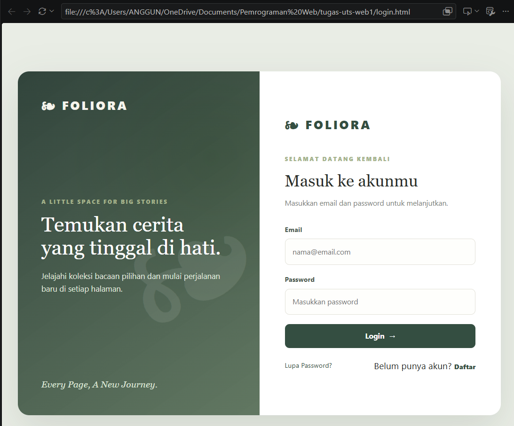
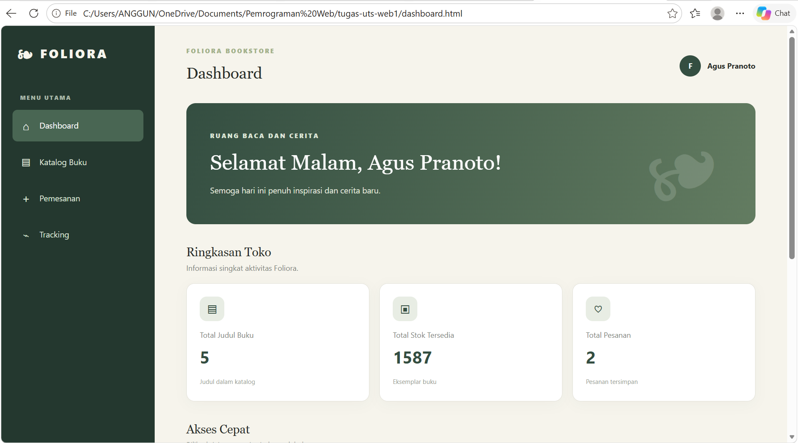
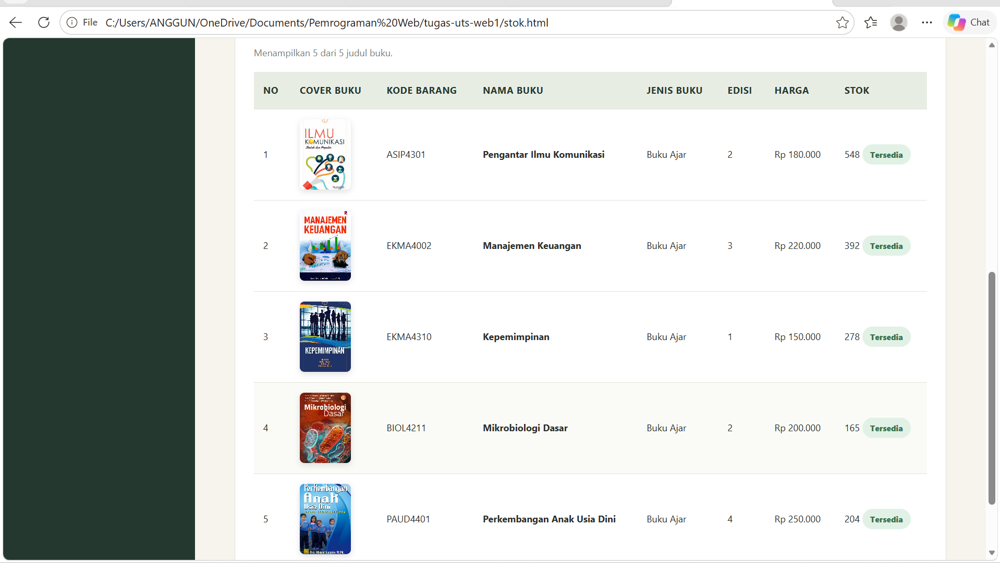
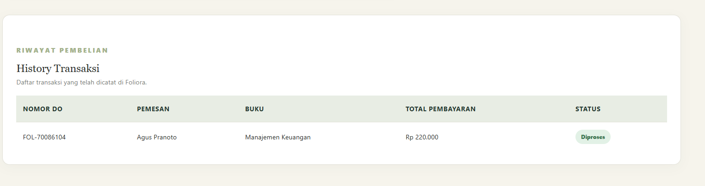
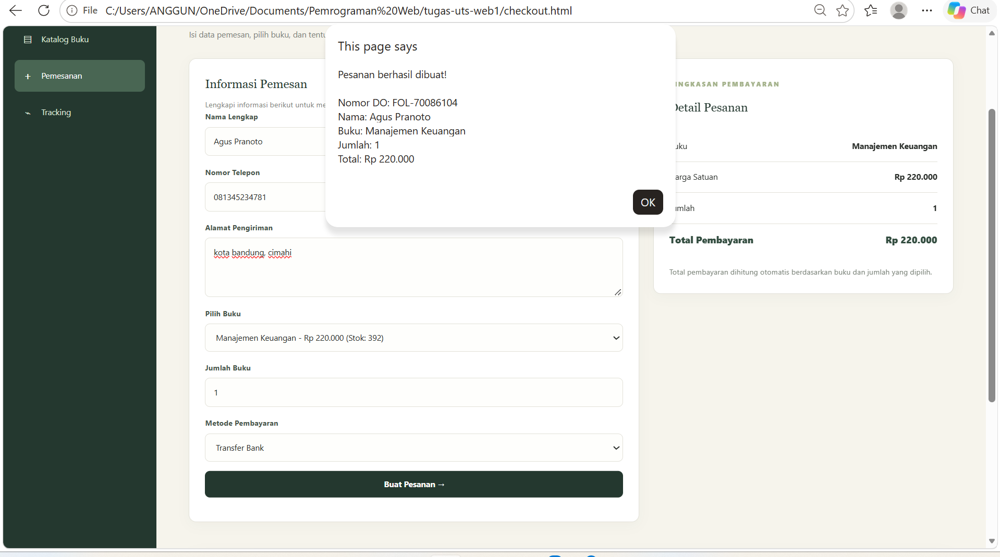
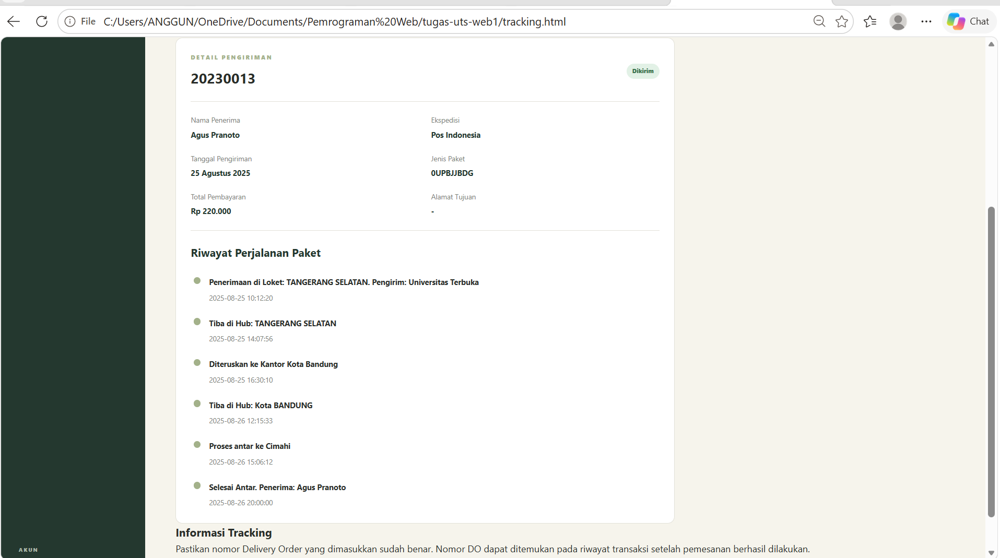
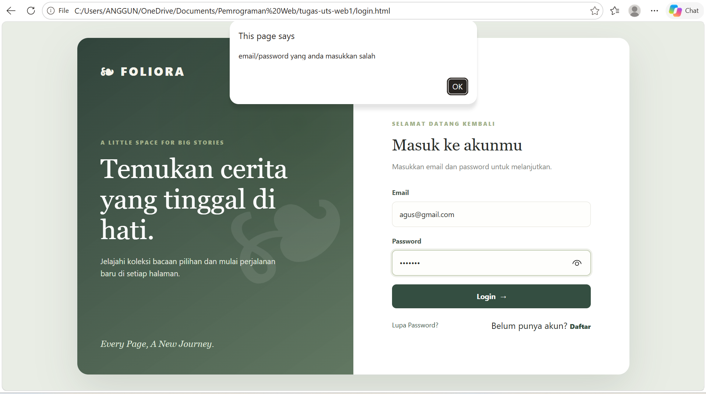

# FOLIORA – Website Toko Buku

**Every Page, A New Journey.**

## 1. Identitas Project

| Keterangan | Informasi |
|---|---|
| Nama Project | Foliora – Website Toko Buku |
| Mata Kuliah | Pemrograman Web 1 |
| Jenis Project | Ujian Tengah Semester (UTS) |
| Nama Mahasiswa | Anggun Kusuma Wardani|
| NIM | 312510045 |
| Dosen Pengampu | Agung Nugroho, S.Kom., M.Kom., S.Kom., M. Kom |
| Teknologi | HTML, CSS, dan JavaScript |

## 2. Deskripsi Project

Foliora merupakan sebuah website toko buku yang dirancang untuk membantu proses pengelolaan katalog buku, pemesanan, dan pelacakan pengiriman. Website ini memiliki tampilan modern dengan konsep botanical bookstore yang menggunakan perpaduan warna hijau, sage, dan ivory sehingga memberikan kesan sederhana, elegan, dan nyaman dilihat.

Project ini dibuat sebagai penerapan materi Pemrograman Web 1, khususnya penggunaan HTML untuk membangun struktur halaman, CSS untuk mengatur tampilan, serta JavaScript untuk mengelola data dan memberikan interaksi pada website.

Foliora terdiri dari lima halaman utama, yaitu Login, Dashboard, Katalog Buku (stok), Checkout, dan Tracking. Setiap halaman memiliki fungsi yang berbeda tetapi saling terhubung untuk membentuk alur penggunaan website toko buku.

Website ini menggunakan data simulasi dari JavaScript dan penyimpanan browser melalui Local Storage serta Session Storage. Dengan demikian, project ini merupakan aplikasi front-end dan belum menggunakan database maupun backend server.

## 3. Tujuan Pembuatan

Tujuan pembuatan website Foliora adalah:

1. Menerapkan penggunaan HTML dalam membangun struktur halaman website.
2. Menerapkan CSS untuk mengatur tata letak, warna, ukuran, dan tampilan website.
3. Memahami penggunaan JavaScript untuk mengelola data dan memberikan interaksi.
4. Mengimplementasikan DOM (Document Object Model) untuk menampilkan dan mengubah elemen HTML secara dinamis.
5. Membuat validasi form pada proses login dan pemesanan.
6. Mengimplementasikan Local Storage dan Session Storage untuk menyimpan data sementara pada browser.
7. Membuat website toko buku yang memiliki beberapa halaman dengan fungsi yang saling terhubung.

## 4. Fitur Website

### A. Login (`login.html`)

Halaman login merupakan halaman pertama yang ditampilkan ketika pengguna membuka website Foliora.

Fitur yang tersedia:
- Form input email dan password.
- Validasi email dan password berdasarkan data pengguna.
- Menampilkan pesan kesalahan apabila data login tidak sesuai.
- Fitur Forgot Password dalam bentuk modal.
- Fitur Register dalam bentuk modal.
- Menyimpan informasi pengguna yang berhasil login menggunakan Session Storage.

### B. Dashboard (`dashboard.html`)

Dashboard merupakan halaman utama yang ditampilkan setelah pengguna berhasil login.

Fitur yang tersedia:
- Menampilkan sapaan berdasarkan waktu, seperti Selamat Pagi, Selamat Siang, Selamat Sore, atau Selamat Malam.
- Menampilkan nama pengguna yang sedang login.
- Menampilkan jumlah judul buku.
- Menampilkan total stok buku.
- Menampilkan jumlah data pesanan dan pengiriman.
- Menyediakan navigasi menuju halaman katalog, checkout, dan tracking.
- Menyediakan tombol logout.

### C. Katalog Buku (`stok.html`)

Halaman katalog buku digunakan untuk menampilkan dan mengelola informasi persediaan buku.

Fitur yang tersedia:
- Menampilkan data buku secara dinamis menggunakan JavaScript.
- Menampilkan cover buku.
- Menampilkan kode barang, nama buku, jenis buku, edisi, harga, dan stok.
- Menampilkan jumlah judul buku dan total stok.
- Fitur pencarian buku berdasarkan informasi katalog.
- Form untuk menambahkan buku baru.
- Menyimpan perubahan data buku menggunakan Local Storage.

Data katalog awal terdiri dari lima judul buku, yaitu Pengantar Ilmu Komunikasi, Manajemen Keuangan, Kepemimpinan, Mikrobiologi Dasar, dan Perkembangan Anak Usia Dini.

### D. Checkout (`checkout.html`)

Halaman checkout digunakan untuk melakukan simulasi pemesanan buku.

Fitur yang tersedia:
- Form identitas pelanggan.
- Input nama, nomor telepon, dan alamat pengiriman.
- Memilih buku yang ingin dipesan.
- Menentukan jumlah buku yang dibeli.
- Memilih metode pembayaran.
- Menampilkan ringkasan pesanan secara otomatis.
- Menghitung total pembayaran berdasarkan harga dan jumlah buku.
- Memvalidasi data sebelum pesanan diproses.
- Mengurangi jumlah stok buku setelah pemesanan berhasil.
- Membuat nomor Delivery Order (DO) secara otomatis.
- Menampilkan riwayat pemesanan.

### E. Tracking (`tracking.html`)

Halaman tracking digunakan untuk melihat informasi dan perkembangan pengiriman pesanan.

Fitur yang tersedia:
- Input nomor Delivery Order (DO).
- Validasi nomor DO.
- Menampilkan informasi pelanggan.
- Menampilkan nama buku dan jumlah pesanan.
- Menampilkan ekspedisi pengiriman.
- Menampilkan tanggal pengiriman dan jenis paket.
- Menampilkan total pembayaran.
- Menampilkan alamat pengiriman.
- Menampilkan riwayat perjalanan paket dalam bentuk timeline.

Data tracking dapat berasal dari data simulasi awal maupun pesanan baru yang dibuat melalui halaman checkout.

## 5. Struktur Folder dan File Project

Berikut merupakan struktur folder yang digunakan dalam project Foliora:

```text
tugas-uts-web1/
│
├── assets/
│   ├── pengantar_komunikasi.jpg
│   ├── manajemen_keuangan.jpg
│   ├── kepemimpinan.jpg
│   ├── mikrobiologi.jpg
│   └── paud_perkembangan.jpg
│
├── css/
│   └── style.css
│
├── js/
│   ├── data.js
│   ├── login.js
│   ├── dashboard.js
│   ├── stok.js
│   ├── checkout.js
│   └── tracking.js
│
├── login.html
├── dashboard.html
├── stok.html
├── checkout.html
├── tracking.html
│
├── screenshots/
│   ├── 01-login.png
│   ├── 02-dashboard.png
│   ├── 03-stok.png
│   ├── 04-riwayat-pemesanan.png
│   ├── 05-checkout.png
│   ├── 06.tracking.png
│   └── 07-validasi-login.png
│
└── README.md
```

### Penjelasan Struktur Folder

**1. Folder `assets/`**

Folder ini digunakan untuk menyimpan seluruh file gambar yang digunakan dalam website Foliora, terutama gambar cover buku pada halaman katalog.

- `pengantar_komunikasi.jpg`: Cover buku Pengantar Ilmu Komunikasi.
- `manajemen_keuangan.jpg`: Cover buku Manajemen Keuangan.
- `kepemimpinan.jpg`: Cover buku Kepemimpinan.
- `mikrobiologi.jpg`: Cover buku Mikrobiologi Dasar.
- `paud_perkembangan.jpg`: Cover buku Perkembangan Anak Usia Dini.

**2. Folder `css/`**

Folder ini berisi file stylesheet yang digunakan untuk mengatur tampilan seluruh halaman website.

- `style.css`: Berisi pengaturan warna, font, ukuran elemen, layout, sidebar, tombol, form, tabel, card, dan tampilan responsif website Foliora.

**3. Folder `js/`**

Folder ini berisi file JavaScript yang mengatur fungsi dan interaksi pada masing-masing halaman.

| File | Fungsi |
|---|---|
| `data.js` | Menyimpan data pengguna, katalog buku, dan tracking serta menyediakan fungsi penyimpanan dan pengambilan data. |
| `login.js` | Mengatur proses login, validasi akun, dan modal Forgot Password serta Register. |
| `dashboard.js` | Mengatur sapaan pengguna, informasi statistik, dan tombol logout pada dashboard. |
| `stok.js` | Mengatur tampilan katalog, pencarian buku, penambahan buku, serta pembaruan jumlah stok. |
| `checkout.js` | Mengatur proses pemesanan, validasi form, perhitungan pembayaran, dan riwayat pesanan. |
| `tracking.js` | Mengatur pencarian nomor DO dan menampilkan informasi serta riwayat pengiriman. |

**4. File HTML**

File HTML merupakan struktur utama dari masing-masing halaman website.

- `login.html`: Halaman untuk masuk ke website.
- `dashboard.html`: Halaman utama setelah login.
- `stok.html`: Halaman pengelolaan katalog dan stok buku.
- `checkout.html`: Halaman pemesanan dan pembayaran.
- `tracking.html`: Halaman pelacakan pengiriman.

**5. Folder `screenshots/`**

Folder ini digunakan untuk menyimpan bukti hasil implementasi website. Screenshot diambil ketika website dijalankan melalui browser dan menunjukkan tampilan maupun fungsi dari setiap halaman.

**6. File `README.md`**

File ini berisi dokumentasi project yang menjelaskan identitas, tujuan, fitur, struktur folder, teknologi, cara menjalankan website, dan bukti implementasi.

## 6. Teknologi yang Digunakan

### HTML
HTML digunakan untuk membangun struktur setiap halaman website, seperti form login, navigasi, tabel katalog, form checkout, dan informasi tracking.

### CSS
CSS digunakan untuk mengatur tampilan website agar lebih menarik dan konsisten. Pengaturan mencakup warna, font, jarak, ukuran, layout, tombol, tabel, dan responsivitas.

### JavaScript
JavaScript digunakan untuk membuat website lebih interaktif, seperti validasi login, pengelolaan data buku, perhitungan total pembayaran, pencarian nomor DO, serta manipulasi elemen HTML.

### DOM (Document Object Model)
DOM digunakan untuk mengakses dan memanipulasi elemen HTML melalui JavaScript. Contohnya adalah menampilkan data buku ke dalam tabel, memperbarui ringkasan checkout, dan menampilkan hasil tracking berdasarkan nomor DO.

### Local Storage
Local Storage digunakan untuk menyimpan data katalog, pesanan, dan pengiriman pada browser sehingga data tetap tersedia ketika halaman dimuat ulang pada browser yang sama.

### Session Storage
Session Storage digunakan untuk menyimpan informasi pengguna yang sedang login selama sesi browser berlangsung.

## 7. Cara Menjalankan Website

Untuk menjalankan website Foliora, ikuti langkah-langkah berikut:

1. Pastikan seluruh folder dan file project sudah berada dalam satu folder bernama `tugas-uts-web1`.
2. Buka folder project menggunakan Visual Studio Code.
3. Pastikan struktur folder `assets`, `css`, dan `js` sudah sesuai.
4. Pastikan file gambar buku sudah berada di dalam folder `assets`.
5. Pastikan ekstensi Live Server sudah terpasang di Visual Studio Code.
6. Buka file `login.html`.
7. Klik tombol **Go Live** pada bagian kanan bawah Visual Studio Code.
8. Website akan terbuka melalui browser.
9. Lakukan login menggunakan akun yang tersedia pada data pengguna.

### Akun Login Pengujian

| Nama | Email | Password |
|---|---|---|
| Rina Wulandari | rina@gmail.com | rina123 |
| Agus Pranoto | agus@gmail.com | agus123 |
| Siti Marlina | siti@gmail.com | siti123 |

Catatan: Akun di atas merupakan data simulasi yang digunakan untuk pengujian fitur login.

## 8. Bukti Screenshot Implementasi

Screenshot berikut digunakan sebagai bukti bahwa setiap halaman dan fitur website telah dibuat serta dijalankan.

**1. Halaman Login**

Menampilkan halaman awal Foliora yang berisi form email dan password, tombol login, serta fitur Forgot Password dan Register.



**2. Halaman Dashboard**

Menampilkan halaman utama setelah pengguna berhasil login, termasuk sapaan pengguna, informasi jumlah buku, total stok, dan navigasi website.




**3. Halaman Katalog Buku**

Menampilkan daftar buku beserta cover, kode barang, nama buku, jenis buku, edisi, harga, dan jumlah stok.




**4. Form Riwayat Pemesanan**

Menampilkan daftar pesanan yang telah dibuat melalui halaman checkout beserta informasi nomor DO dan status pesanan.




**5. Halaman Checkout**

Menampilkan form pemesanan yang berisi data pelanggan, pilihan buku, jumlah pembelian, metode pembayaran, dan ringkasan total pembayaran.




**6. Halaman Tracking**

Menampilkan hasil pencarian nomor DO, informasi pelanggan, ekspedisi, status pengiriman, dan riwayat perjalanan paket.



**8. Bukti Validasi Login**

Menampilkan pesan kesalahan ketika pengguna memasukkan email atau password yang tidak sesuai.




## 8. Alur Penggunaan Website

Alur penggunaan website Foliora adalah sebagai berikut:

1. Pengguna membuka website melalui halaman login.
2. Pengguna memasukkan email dan password.
3. Jika data sesuai, pengguna diarahkan menuju dashboard.
4. Pengguna dapat membuka halaman katalog untuk melihat atau menambahkan buku.
5. Pengguna dapat melakukan pemesanan melalui halaman checkout.
6. Sistem menghitung total pembayaran dan membuat nomor DO.
7. Data pesanan disimpan dan ditampilkan pada riwayat pesanan.
8. Pengguna dapat membuka halaman tracking untuk melihat informasi pengiriman berdasarkan nomor DO.

## 9. Video Presentasi Project

Video berikut merupakan dokumentasi presentasi dan demonstrasi website Foliora sebagai bagian dari penyelesaian Ujian Tengah Semester mata kuliah Pemrograman Web 1.

Dalam video ini dijelaskan mengenai:
- Proses login dan validasi akun.
- Tampilan Dashboard dan Greeting berdasarkan waktu.
- Informasi katalog dan stok buku.
- Proses pemesanan melalui halaman Checkout.
- Riwayat transaksi.
- Informasi pengiriman dan fitur Tracking.

**Link Video Presentasi:**

[Klik di sini untuk menonton video presentasi Foliora](https://youtu.be/7BgjEl6RfXg)

## 10. Kesimpulan

Pembuatan website Foliora merupakan implementasi materi Pemrograman Web 1 dengan memanfaatkan HTML, CSS, dan JavaScript. Website ini dirancang untuk memberikan simulasi sistem toko buku yang memiliki fitur login, dashboard, pengelolaan katalog, pemesanan, dan pelacakan pengiriman.

Melalui project ini, penggunaan DOM, validasi form, manipulasi elemen HTML, Local Storage, dan Session Storage dapat diterapkan secara langsung. Selain itu, pembagian file HTML, CSS, dan JavaScript ke dalam struktur folder yang terorganisasi membuat project lebih mudah dipahami, dikembangkan, dan dipelihara.

Website Foliora diharapkan dapat menjadi bentuk penerapan keterampilan dalam membangun website interaktif menggunakan teknologi front-end.

---

**Project UTS Pemrograman Web 1 – Foliora**  
*Every Page, A New Journey.*

